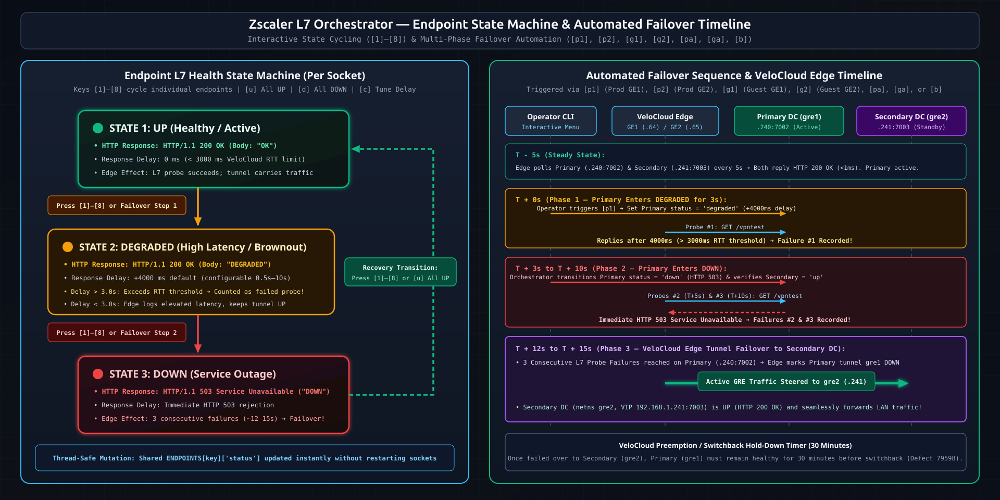
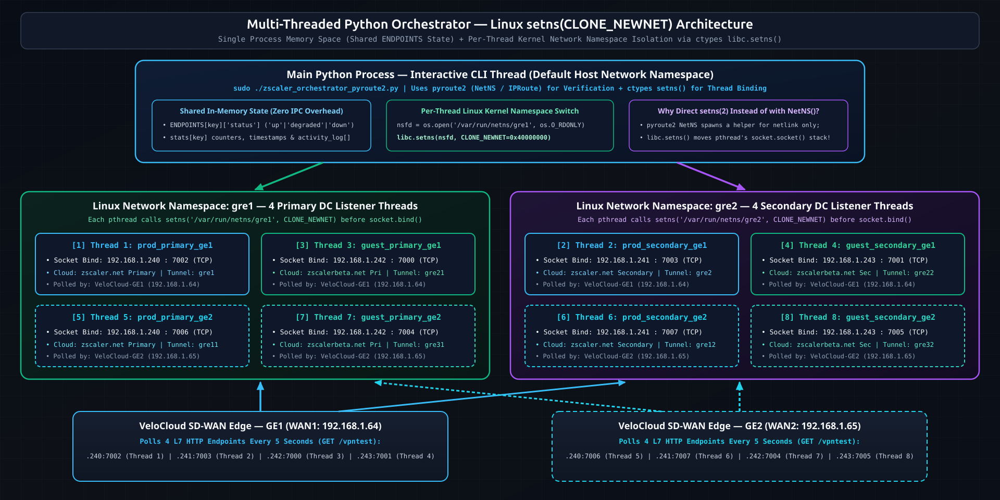

# Zscaler GRE Tunnel Orchestrator - CLI Usage Guide (`pyroute2` Version)



## Quick Start

### 1. Install `pyroute2`

```bash
# Option A: Using apt-get (Ubuntu/Debian - RECOMMENDED for sudo execution)
sudo apt-get update
sudo apt-get install -y python3-pyroute2

# Option B: Using pip system-wide
sudo pip3 install pyroute2

# Option C: Using a virtual environment
python3 -m venv venv
source venv/bin/activate
pip install pyroute2
# Note: With venv, run: sudo venv/bin/python zscaler_orchestrator_pyroute2.py

# Verify installation
sudo python3 -c "from pyroute2 import NetNS; print('pyroute2 installed successfully')"
```

### 2. Ensure Network Namespaces & GRE Tunnels Are Configured

```bash
# 1. Create bridge br1 and namespaces gre1 & gre2
sudo ./mknetns-gre1.sh

# 2. Configure VIPs (192.168.1.240-243) and 8 GRE tunnels
sudo ./doit.sh

# 3. Verify namespaces exist
ip netns list
# Expected: gre1, gre2
```

### 3. Run the Interactive CLI Orchestrator

```bash
# Must run as root to switch threads into network namespaces via setns()
sudo ./zscaler_orchestrator_pyroute2.py
```

---

## Interactive Commands

Once running, use these commands to bring individual endpoints or tunnel pools `UP`, `DEGRADED`, and `DOWN`:

### Individual Endpoint Control (8 Endpoints Total)

Each menu key (`[1]`–`[8]`) controls one specific **unique `(Segment / Zscaler Cloud, Primary/Secondary DC, Edge WAN Interface)` tuple**:

| Key | Segment | Zscaler Cloud & DC Role | WAN $\rightarrow$ VIP | L7 Socket | NetNS / GRE |
| :-: | :--- | :--- | :--- | :--- | :--- |
| **`[1]`** | **Trusted** (`.23.0/24`) | **`zscaler.net`** Primary (`0`) | `GE1 .64 -> .240` | `.240:7002` | `gre1` / `gre1` |
| **`[2]`** | **Trusted** (`.23.0/24`) | **`zscaler.net`** Secondary (`1`) | `GE1 .64 -> .241` | `.241:7003` | `gre2` / `gre2` |
| **`[3]`** | **Guest** (`.16.0/24`) | **`zscalerbeta.net`** Primary (`0`) | `GE1 .64 -> .242` | `.242:7000` | `gre1` / `gre21` |
| **`[4]`** | **Guest** (`.16.0/24`) | **`zscalerbeta.net`** Secondary (`1`) | `GE1 .64 -> .243` | `.243:7001` | `gre2` / `gre22` |
| **`[5]`** | **Trusted** (`.23.0/24`) | **`zscaler.net`** Primary (`0`) | `GE2 .65 -> .240` | `.240:7006` | `gre1` / `gre11` |
| **`[6]`** | **Trusted** (`.23.0/24`) | **`zscaler.net`** Secondary (`1`) | `GE2 .65 -> .241` | `.241:7007` | `gre2` / `gre12` |
| **`[7]`** | **Guest** (`.16.0/24`) | **`zscalerbeta.net`** Primary (`0`) | `GE2 .65 -> .242` | `.242:7004` | `gre1` / `gre31` |
| **`[8]`** | **Guest** (`.16.0/24`) | **`zscalerbeta.net`** Secondary (`1`) | `GE2 .65 -> .243` | `.243:7005` | `gre2` / `gre32` |

#### Detailed Per-Menu-Item Breakdown

**GE1 Endpoints (VeloCloud Edge WAN1 `192.168.1.64`):**
- **`[1]` — Toggle Prod Primary GE1 (`192.168.1.240:7002` in `gre1`, tunnel `gre1`)**
  - **Segment Served:** Trusted / Production LAN (`10.23.0.0/24`)
  - **Zscaler Cloud & Role:** **`zscaler.net` — Primary DC** (`destId: 0`, VIP `192.168.1.240`)
  - **WAN Link & Tunnel:** Edge `GE1` (`192.168.1.64`) $\rightarrow$ `netns gre1` (`gre1`, inner `/30`: `172.21.12.161` $\leftrightarrow$ `.162`)
- **`[2]` — Toggle Prod Secondary GE1 (`192.168.1.241:7003` in `gre2`, tunnel `gre2`)**
  - **Segment Served:** Trusted / Production LAN (`10.23.0.0/24`)
  - **Zscaler Cloud & Role:** **`zscaler.net` — Secondary DC** (`destId: 1`, VIP `192.168.1.241`)
  - **WAN Link & Tunnel:** Edge `GE1` (`192.168.1.64`) $\rightarrow$ `netns gre2` (`gre2`, inner `/30`: `172.21.12.165` $\leftrightarrow$ `.166`)
- **`[3]` — Toggle Guest Primary GE1 (`192.168.1.242:7000` in `gre1`, tunnel `gre21`)**
  - **Segment Served:** Guest Wi-Fi / Untrusted LAN (`172.16.0.0/24`)
  - **Zscaler Cloud & Role:** **`zscalerbeta.net` — Primary DC** (`destId: 0`, VIP `192.168.1.242`)
  - **WAN Link & Tunnel:** Edge `GE1` (`192.168.1.64`) $\rightarrow$ `netns gre1` (`gre21`, inner `/30`: `172.20.67.33` $\leftrightarrow$ `.34`)
- **`[4]` — Toggle Guest Secondary GE1 (`192.168.1.243:7001` in `gre2`, tunnel `gre22`)**
  - **Segment Served:** Guest Wi-Fi / Untrusted LAN (`172.16.0.0/24`)
  - **Zscaler Cloud & Role:** **`zscalerbeta.net` — Secondary DC** (`destId: 1`, VIP `192.168.1.243`)
  - **WAN Link & Tunnel:** Edge `GE1` (`192.168.1.64`) $\rightarrow$ `netns gre2` (`gre22`, inner `/30`: `172.20.67.37` $\leftrightarrow$ `.38`)

**GE2 Endpoints (VeloCloud Edge WAN2 `192.168.1.65`):**
- **`[5]` — Toggle Prod Primary GE2 (`192.168.1.240:7006` in `gre1`, tunnel `gre11`)**
  - **Segment Served:** Trusted / Production LAN (`10.23.0.0/24`)
  - **Zscaler Cloud & Role:** **`zscaler.net` — Primary DC** (`destId: 0`, VIP `192.168.1.240`)
  - **WAN Link & Tunnel:** Edge `GE2` (`192.168.1.65`) $\rightarrow$ `netns gre1` (`gre11`, inner `/30`: `172.21.12.169` $\leftrightarrow$ `.170`)
- **`[6]` — Toggle Prod Secondary GE2 (`192.168.1.241:7007` in `gre2`, tunnel `gre12`)**
  - **Segment Served:** Trusted / Production LAN (`10.23.0.0/24`)
  - **Zscaler Cloud & Role:** **`zscaler.net` — Secondary DC** (`destId: 1`, VIP `192.168.1.241`)
  - **WAN Link & Tunnel:** Edge `GE2` (`192.168.1.65`) $\rightarrow$ `netns gre2` (`gre12`, inner `/30`: `172.21.12.173` $\leftrightarrow$ `.174`)
- **`[7]` — Toggle Guest Primary GE2 (`192.168.1.242:7004` in `gre1`, tunnel `gre31`)**
  - **Segment Served:** Guest Wi-Fi / Untrusted LAN (`172.16.0.0/24`)
  - **Zscaler Cloud & Role:** **`zscalerbeta.net` — Primary DC** (`destId: 0`, VIP `192.168.1.242`)
  - **WAN Link & Tunnel:** Edge `GE2` (`192.168.1.65`) $\rightarrow$ `netns gre1` (`gre31`, inner `/30`: `172.20.67.41` $\leftrightarrow$ `.42`)
- **`[8]` — Toggle Guest Secondary GE2 (`192.168.1.243:7005` in `gre2`, tunnel `gre32`)**
  - **Segment Served:** Guest Wi-Fi / Untrusted LAN (`172.16.0.0/24`)
  - **Zscaler Cloud & Role:** **`zscalerbeta.net` — Secondary DC** (`destId: 1`, VIP `192.168.1.243`)
  - **WAN Link & Tunnel:** Edge `GE2` (`192.168.1.65`) $\rightarrow$ `netns gre2` (`gre32`, inner `/30`: `172.20.67.45` $\leftrightarrow$ `.46`)

Each press cycles the selected endpoint: **`UP` -> `DEGRADED` -> `DOWN` -> `UP`**

### Automated Failover Scenarios

**Single-Interface Failovers (Primary DC $\rightarrow$ Secondary DC within the same Zscaler Cloud):**
- **`[p1]` — Trusted / Production `GE1` Failover (`zscaler.net` on WAN1 `192.168.1.64`)**
  - **Segment Served:** Trusted / Production LAN (`10.23.0.0/24`)
  - **Cloud Transition:** **`zscaler.net` Primary DC** (`.240:7002`, tunnel `gre1` in `netns gre1`) degrades & fails $\rightarrow$ traffic shifts to **`zscaler.net` Secondary DC** (`.241:7003`, tunnel `gre2` in `netns gre2`).
- **`[p2]` — Trusted / Production `GE2` Failover (`zscaler.net` on WAN2 `192.168.1.65`)**
  - **Segment Served:** Trusted / Production LAN (`10.23.0.0/24`)
  - **Cloud Transition:** **`zscaler.net` Primary DC** (`.240:7006`, tunnel `gre11` in `netns gre1`) degrades & fails $\rightarrow$ traffic shifts to **`zscaler.net` Secondary DC** (`.241:7007`, tunnel `gre12` in `netns gre2`).
- **`[g1]` — Guest Segment `GE1` Failover (`zscalerbeta.net` on WAN1 `192.168.1.64`)**
  - **Segment Served:** Guest Wi-Fi / Untrusted LAN (`172.16.0.0/24`)
  - **Cloud Transition:** **`zscalerbeta.net` Primary DC** (`.242:7000`, tunnel `gre21` in `netns gre1`) degrades & fails $\rightarrow$ traffic shifts to **`zscalerbeta.net` Secondary DC** (`.243:7001`, tunnel `gre22` in `netns gre2`).
- **`[g2]` — Guest Segment `GE2` Failover (`zscalerbeta.net` on WAN2 `192.168.1.65`)**
  - **Segment Served:** Guest Wi-Fi / Untrusted LAN (`172.16.0.0/24`)
  - **Cloud Transition:** **`zscalerbeta.net` Primary DC** (`.242:7004`, tunnel `gre31` in `netns gre1`) degrades & fails $\rightarrow$ traffic shifts to **`zscalerbeta.net` Secondary DC** (`.243:7005`, tunnel `gre32` in `netns gre2`).

**Multi-Interface Failovers:**
- **`[pa]` — Trusted / Production Dual-WAN Failover (`zscaler.net` on BOTH `GE1 + GE2` simultaneously)**
  - **Segment Served:** Trusted / Production LAN (`10.23.0.0/24`)
  - **Cloud Transition:** Fails over both `GE1` (`gre1 -> gre2`) and `GE2` (`gre11 -> gre12`) from **`zscaler.net` Primary DC (`.240`)** to **`zscaler.net` Secondary DC (`.241`)**.
- **`[ga]` — Guest Segment Dual-WAN Failover (`zscalerbeta.net` on BOTH `GE1 + GE2` simultaneously)**
  - **Segment Served:** Guest Wi-Fi / Untrusted LAN (`172.16.0.0/24`)
  - **Cloud Transition:** Fails over both `GE1` (`gre21 -> gre22`) and `GE2` (`gre31 -> gre32`) from **`zscalerbeta.net` Primary DC (`.242`)** to **`zscalerbeta.net` Secondary DC (`.243`)**.
- **`[b]` — Full Datacenter Outage Failover (ALL 4 Primary Tunnels across BOTH Clouds & BOTH WANs)**
  - **Segments Served:** Both Trusted (`10.23.0.0/24`) and Guest (`172.16.0.0/24`)
  - **Cloud Transition:** Simulates a complete Primary DC outage (`netns gre1`) across **`zscaler.net` (`.240`)** and **`zscalerbeta.net` (`.242`)** on both `GE1` and `GE2`, shifting all 4 active tunnels to their respective **Secondary DCs (`netns gre2`, `.241` & `.243`)**.

Each automated failover executes a 3-phase transition:
1. Primary endpoint enters **`DEGRADED`** for 3 seconds (delayed `200 OK` responses).
2. Primary endpoint enters **`DOWN`** for 2 seconds (`503 Service Unavailable`).
3. Secondary endpoint is verified **`UP`** (`200 OK`) to take over traffic.

### Bulk Operations & Tuning
- **`[u]`** — Bring all 8 endpoints **`UP`**
- **`[d]`** — Take all 8 endpoints **`DOWN`**
- **`[c]`** — Configure `DEGRADED` delay (default `4.0s`; VeloCloud RTT threshold is `3.0s`)

### Monitoring & Inspection
- **`[s]`** — Refresh status dashboard
- **`[l]`** — Show recent activity logs (last 30 lines)
- **`[n]`** — Show live namespace network configuration (`IPRoute` interface & IP inspection)
- **`[q]`** — Quit orchestrator cleanly

---

## Endpoint Health States


### 1. `UP` (Green)
- **HTTP Response:** `HTTP/1.1 200 OK` (immediate, `< 1 ms`)
- **Response Body:** `OK`
- **VeloCloud Edge Effect:** Marks L7 health check as healthy; tunnel eligible to carry traffic.

### 2. `DEGRADED` (Yellow)
- **HTTP Response:** `HTTP/1.1 200 OK` delayed by `DEGRADED_DELAY` (default `4.0s`, configurable `0.5s`–`10.0s` via `[c]`)
- **Response Body:** `DEGRADED`
- **VeloCloud Edge Effect:**
  - If delay `> 3.0s` (VeloCloud's L7 RTT threshold): VeloCloud treats the probe as timed out / failed and fails over after 3 consecutive slow probes.
  - If delay `< 3.0s`: VeloCloud records elevated latency while keeping the tunnel up.

### 3. `DOWN` (Red)
- **HTTP Response:** `HTTP/1.1 503 Service Unavailable` (immediate)
- **Response Body:** `DOWN`
- **VeloCloud Edge Effect:** Probe fails immediately; after 3 consecutive failures (~10–15 seconds), VeloCloud switches traffic to the Secondary Zscaler tunnel.

---

## Dashboard Layout

```text
====================================================================================================
                   Zscaler GRE Tunnel Orchestrator - VeloCloud Failover Simulator
                               (pyroute2 version - 8 Tunnel Support)
====================================================================================================

GE1 Endpoints (Edge 192.168.1.64):
Production:
* Prod Primary GE1     UP          192.168.1.240:7002 (gre1)  Checks: 1234  Last: 14:23:45 from 192.168.1.64:12345
o Prod Secondary GE1   DOWN        192.168.1.241:7003 (gre2)  Checks: 45    Last: 14:20:12 from 192.168.1.64:12340
Guest:
* Guest Primary GE1    UP          192.168.1.242:7000 (gre1)  Checks: 982   Last: 14:23:44 from 192.168.1.64:12346
~ Guest Secondary GE1  DEGRADED    192.168.1.243:7001 (gre2)  Checks: 123   Last: 14:23:40 from 192.168.1.64:12341

GE2 Endpoints (Edge 192.168.1.65):
Production:
* Prod Primary GE2     UP          192.168.1.240:7006 (gre1)  Checks: 1189  Last: 14:23:46 from 192.168.1.65:22345
* Prod Secondary GE2   UP          192.168.1.241:7007 (gre2)  Checks: 67    Last: 14:21:15 from 192.168.1.65:22340
Guest:
* Guest Primary GE2    UP          192.168.1.242:7004 (gre1)  Checks: 945   Last: 14:23:43 from 192.168.1.65:22346
* Guest Secondary GE2  UP          192.168.1.243:7005 (gre2)  Checks: 101   Last: 14:22:30 from 192.168.1.65:22341
```

---

## Multi-Threaded Namespace Architecture



<details>
<summary>📟 View Terminal-Friendly ASCII Thread Architecture Diagram</summary>

```text
+-----------------------------------------------------------------------------+
|                         Main Thread (Interactive CLI)                       |
|  - Renders live status dashboard                                            |
|  - Mutates shared ENDPOINTS[key]['status'] ('up' | 'degraded' | 'down')     |
|  - Coordinates automated failover threads                                   |
+--------------------------------------+--------------------------------------+
                                       |
         +-----------------------------+-----------------------------+
         |                             |                             |
         v                             v                             v
+--------------------+       +--------------------+       +--------------------+
| Listener Thread 1  |       | Listener Thread 2  |       | Listener Threads   |
| Prod Primary GE1   |       | Prod Secondary GE1 |       | 3..8 (GE1 & GE2)   |
| setns('gre1')      |       | setns('gre2')      |       | setns('gre1/gre2') |
| 192.168.1.240:7002 |       | 192.168.1.241:7003 |       | :7000..:7007       |
+---------+----------+       +---------+----------+       +---------+----------+
          ^                            ^                            ^
          | HTTP GET /vpntest          | HTTP GET /vpntest          |
          +----------------------------+----------------------------+
                                       |
               +-----------------------+-----------------------+
               |                                               |
+--------------+---------------+               +---------------+--------------+
|     VeloCloud Edge GE1       |               |     VeloCloud Edge GE2       |
|        192.168.1.64          |               |        192.168.1.65          |
|  Polls ports 7000, 7001,     |               |  Polls ports 7004, 7005,     |
|              7002, 7003      |               |              7006, 7007      |
+------------------------------+               +------------------------------+
```

</details>

---

## Typical Failover Timeline (Per WAN Interface)

See the **Automated Failover Sequence (`T+0s` to `T+15s`)** panel in the state machine blueprint above (`docs/assets/orchestrator-state-failover.png`):

1. **`T+0s`**: Operator triggers `[p1]` (or presses `[1]` to set `DEGRADED` / `DOWN`).
2. **`T+3s`**: Primary endpoint returns `HTTP 503 Service Unavailable`.
3. **`T+8s–12s`**: VeloCloud Edge records 3 consecutive failed L7 health checks (polled every ~5s).
4. **`T+12s–15s`**: VeloCloud Edge marks the Primary tunnel (`gre1`) down and steers traffic into the Secondary tunnel (`gre2`).
5. **`T+15s+`**: All traffic for that WAN interface flows through the Secondary Zscaler namespace (`gre2`).
