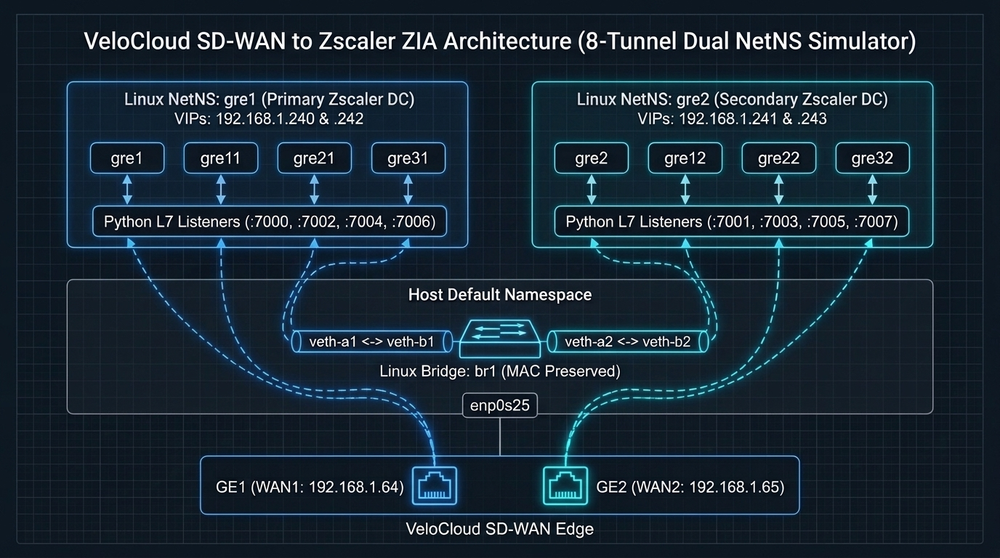
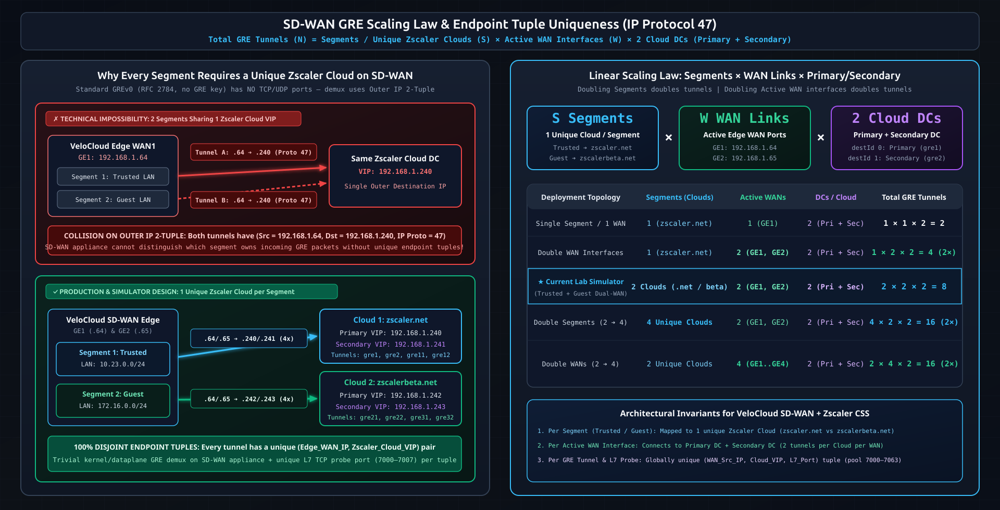
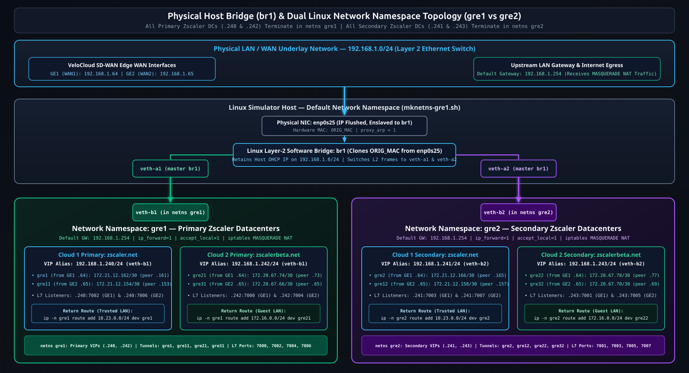
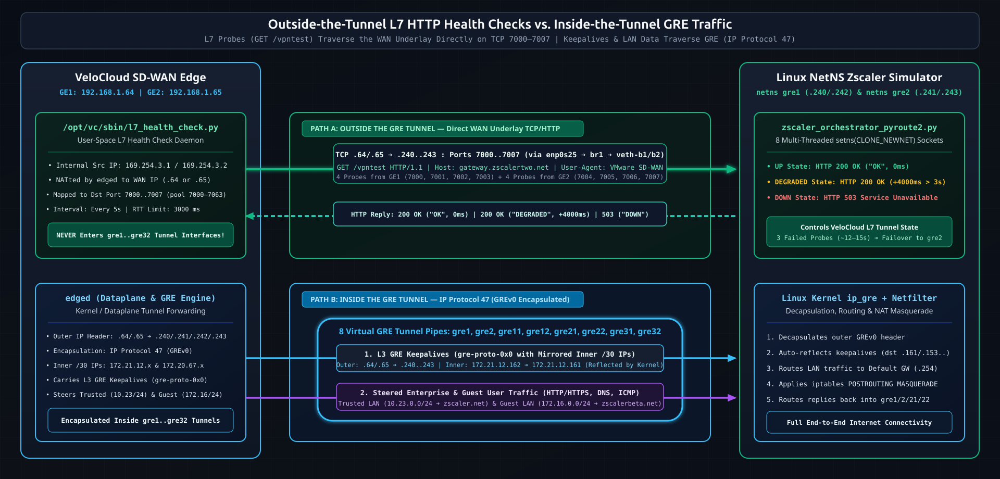
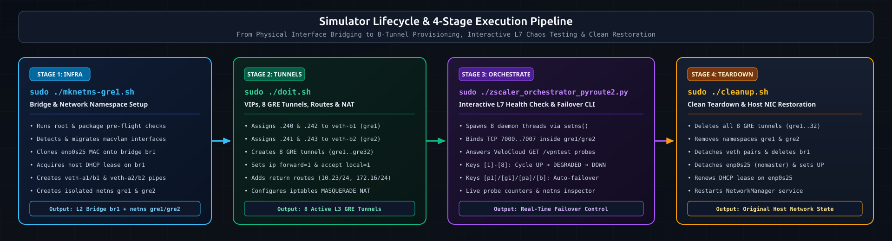

# VeloCloud SD-WAN to Zscaler ZIA GRE Tunnel Simulator & L7 Orchestrator

[-FCC624?logo=linux&logoColor=black)](#1-end-to-end-network-architecture-clouds-scaling-law--unique-tuples)
[-3776AB?logo=python&logoColor=white)](ORCHESTRATOR_USAGE.md)
[](docs/DEEP_DIVE_L7_VS_GRE_HEALTHCHECKS.md)
[](docs/DEEP_DIVE_NAMESPACES_AND_ROUTING.md)
[](LICENSE)



## Overview

This project simulates a complete dual-datacenter **Zscaler Internet Access (ZIA)** GRE tunnel environment on a single Linux host to test, validate, and debug **VMware VeloCloud SD-WAN Edge** Cloud Security Service (CSS) behavior, Layer 7 health checks, and tunnel failover mechanisms.

Using **Linux Network Namespaces (`gre1` and `gre2`)**, a **MAC-preserving Linux Bridge (`br1`)**, **8 GRE tunnels**, and a **multi-threaded Python CLI Orchestrator (`pyroute2` + `setns()`)**, you can deterministically transition individual Zscaler endpoints or entire WAN pools between `UP`, `DEGRADED` (high RTT), and `DOWN` states in real time.

---

## Documentation Index

- **[`README.md`](README.md)** — Architecture overview, SD-WAN GRE scaling law & tuple uniqueness, quick start, setup & teardown, and troubleshooting (this document).
- **[`ORCHESTRATOR_USAGE.md`](ORCHESTRATOR_USAGE.md)** — Complete guide to the interactive Python CLI tool (`zscaler_orchestrator_pyroute2.py`) for bringing endpoints and tunnels `UP`, `DEGRADED`, and `DOWN`.
- **[`QUICK_REFERENCE.md`](QUICK_REFERENCE.md)** — Port map (`7000`–`7007`), GRE tunnel matrix (`gre1`–`gre32`), CLI cheat sheet, and validation one-liners.
- **[`docs/DEEP_DIVE_NAMESPACES_AND_ROUTING.md`](docs/DEEP_DIVE_NAMESPACES_AND_ROUTING.md)** — In-depth explanation of why and how Linux Network Namespaces, `veth` pairs, MAC-preserving bridging, `accept_local=1`, `proxy_arp`, `setns()`, and the 3 return-path routing architectures work.
- **[`docs/DEEP_DIVE_L7_VS_GRE_HEALTHCHECKS.md`](docs/DEEP_DIVE_L7_VS_GRE_HEALTHCHECKS.md)** — Anatomy of VeloCloud **outside-the-tunnel** L7 HTTP health checks (`GET /vpntest`) vs. **inside-the-tunnel** L3 GRE keepalives and user traffic, Edge CLI diagnostics (`/opt/vc/bin/debug.py --l7_health_checks`), and firmware observations.
- **[`CHANGELOG.md`](CHANGELOG.md)** — Evolution from 4-tunnel single-WAN to 8-tunnel dual-WAN (`GE1` + `GE2`) simulation.

---

## 1. End-to-End Network Architecture: Clouds, Scaling Law & Unique Tuples

### 1A. Segment-to-Cloud Mapping, Linear Scaling Law & GRE Tuple Uniqueness



In a multi-segment **VMware VeloCloud SD-WAN** deployment integrated with **Zscaler ZIA**, three architectural rules govern how GRE tunnels (`IP Protocol 47`) and L7 health checks are constructed:

1. **Per Network Segment (`Trusted` / `Guest`), 1 Unique Zscaler Cloud Is Used:**
   - **Trusted / Production Segment (`10.23.0.0/24`)** connects exclusively to **Zscaler Cloud 1 (`zscaler.net`)** (`Primary VIP: 192.168.1.240`, `Secondary VIP: 192.168.1.241`).
   - **Guest Segment (`172.16.0.0/24`)** connects exclusively to **Zscaler Cloud 2 (`zscalerbeta.net`)** (`Primary VIP: 192.168.1.242`, `Secondary VIP: 192.168.1.243`).
2. **Per Active WAN Interface (`GE1` / `GE2`), the Edge Connects to Both Primary and Secondary DCs:**
   - Every active WAN interface establishes **2 GRE tunnels per Zscaler Cloud**: one to the **Primary DC (`destId: 0`)** and one to the **Secondary DC (`destId: 1`)**.
3. **Linear Tunnel Scaling Formula:**
   $$N_{\text{GRE Tunnels}} = S_{\text{Segments (Unique Zscaler Clouds)}} \times W_{\text{Active WAN Interfaces}} \times 2_{\text{ (Primary + Secondary DC)}}$$
   - **Doubling the number of segments** ($S \to 2S$, each mapped to its own unique Zscaler Cloud) **doubles the total number of GRE tunnels**.
   - **Doubling the number of active WAN interfaces** ($W \to 2W$) **doubles the total number of GRE tunnels**.
   - With $S = 2$ segments (`Trusted` + `Guest`) and $W = 2$ WAN links (`GE1` + `GE2`), the Edge builds $2 \times 2 \times 2 = \mathbf{8\text{ GRE tunnels}}$ (4 tunnels per WAN interface, 4 tunnels per segment).

> **Why Unique Endpoint Tuples Prevent Any Technical Impossibility on the SD-WAN Appliance:**
> Standard GREv0 (RFC 2784, without GRE Tunnel Keys) runs directly over IP (**Protocol 47**) and has no TCP/UDP port numbers. On the WAN underlay, a GRE tunnel is uniquely identified by its outer IP 2-tuple:
> $$\text{GRE Underlay Endpoint Tuple} = (\text{Edge WAN Source IP}, \text{Zscaler Cloud DC VIP})$$
> If two different segments attempted to terminate keyless GRE tunnels from the same WAN interface (`GE1 = 192.168.1.64`) onto the **same** Zscaler destination VIP (`192.168.1.240`), both tunnels would share the exact same `(Src: .64, Dst: .240, Proto: 47)` header—creating a demultiplexing conflict in the kernel/dataplane.
>
> Because **every segment uses its own unique Zscaler Cloud (with distinct Primary and Secondary VIPs)** and **every WAN interface has its own unique IP**, **every single GRE tunnel on the SD-WAN appliance is guaranteed to have a 100% unique `(WAN Source IP, Zscaler Cloud VIP)` endpoint tuple** (plus a dedicated L7 HTTP probe port in `7000`–`7063`). This makes it trivial for the SD-WAN appliance to keep all tunnels cleanly separated without any technical impossibility.

### 1B. Physical Host Bridge (`br1`) & Linux Network Namespace Mapping (`gre1` vs `gre2`)

To terminate all 8 GRE tunnels on a single Linux laptop/server without routing table collisions (`10.23.0.0/24` and `172.16.0.0/24`) or local IP bypass, the simulator maps **all Primary DCs (`.240` & `.242`) into namespace `gre1`** and **all Secondary DCs (`.241` & `.243`) into namespace `gre2`**, connected via a MAC-preserving Linux Bridge (`br1`):



<details>
<summary>📟 View Terminal-Friendly ASCII Topology Diagram</summary>

```text
+-----------------------------------------------------------------------------+
|                        Physical LAN / WAN Underlay                          |
|                          192.168.1.0/24 (DHCP)                              |
|                     Gateway / Internet: 192.168.1.254                       |
+--------------------------------------+--------------------------------------+
                                       |
                                +------+------+
                                |   enp0s25   | Physical NIC (IP flushed)
                                +------+------+
                                       |
                                +------+------+
                                |     br1     | Linux Bridge (inherits enp0s25
                                |  (DHCP IP)  | MAC address to keep DHCP lease)
                                +--+-------+--+
                                   |       |
                            +------+--+ +--+------+
                            | veth-a1 | | veth-a2 | Host-side veth interfaces
                            +----+----+ +----+----+
                                 |           |
                            +----+----+ +----+----+
                            | veth-b1 | | veth-b2 | Namespace-side veths
                            +----+----+ +----+----+
                                 |           |
        +------------------------+--+     +--+------------------------+
        |  Network Namespace: gre1  |     |  Network Namespace: gre2  |
        |   (Primary Zscaler DC)    |     |  (Secondary Zscaler DC)   |
        +---------------------------+     +---------------------------+
        | WAN IP Aliases (veth-b1): |     | WAN IP Aliases (veth-b2): |
        | - 192.168.1.240/24 (Prod) |     | - 192.168.1.241/24 (Prod) |
        | - 192.168.1.242/24 (Guest)|     | - 192.168.1.243/24 (Guest)|
        |                           |     |                           |
        | Production GRE Tunnels:   |     | Production GRE Tunnels:   |
        | +-----------------------+ |     | +-----------------------+ |
        | | gre1:  172.21.12.162  | |     | | gre2:  172.21.12.166  | |
        | | peer .161 --> GE1 .64 | |     | | peer .165 --> GE1 .64 | |
        | +-----------------------+ |     | +-----------------------+ |
        | +-----------------------+ |     | +-----------------------+ |
        | | gre11: 172.21.12.154  | |     | | gre12: 172.21.12.158  | |
        | | peer .153 --> GE2 .65 | |     | | peer .157 --> GE2 .65 | |
        | +-----------------------+ |     | +-----------------------+ |
        |                           |     |                           |
        | Guest GRE Tunnels:        |     | Guest GRE Tunnels:        |
        | +-----------------------+ |     | +-----------------------+ |
        | | gre21: 172.20.67.74   | |     | | gre22: 172.20.67.78   | |
        | | peer .73  --> GE1 .64 | |     | | peer .77  --> GE1 .64 | |
        | +-----------------------+ |     | +-----------------------+ |
        | +-----------------------+ |     | +-----------------------+ |
        | | gre31: 172.20.67.66   | |     | | gre32: 172.20.67.70   | |
        | | peer .65  --> GE2 .65 | |     | | peer .69  --> GE2 .65 | |
        | +-----------------------+ |     | +-----------------------+ |
        |                           |     |                           |
        | L7 HTTP Listeners:        |     | L7 HTTP Listeners:        |
        | - .240:7002 (Prod GE1)    |     | - .241:7003 (Prod GE1)    |
        | - .240:7006 (Prod GE2)    |     | - .241:7007 (Prod GE2)    |
        | - .242:7000 (Guest GE1)   |     | - .243:7001 (Guest GE1)   |
        | - .242:7004 (Guest GE2)   |     | - .243:7005 (Guest GE2)   |
        +-------------+-------------+     +-------------+-------------+
                      |                                 |
                      +----------------+----------------+
                                       |
                         All 8 GRE tunnels & L7 probes
                         terminate at VeloCloud Edge:
                         +---------------------------+
                         | GE1 (WAN1): 192.168.1.64  |
                         | GE2 (WAN2): 192.168.1.65  |
                         +---------------------------+
```

</details>

### Simulated Zscaler Endpoints & 8-Tunnel Matrix

| # | Segment | Zscaler Cloud & DC Role | Simulated Zscaler VIP | Namespace | WAN Link | Edge WAN IP | GRE Interface | Simulator Inner IP (/30) | Edge Inner Peer IP | L7 Probe Port |
| :-: | :--- | :--- | :--- | :--- | :--- | :--- | :--- | :--- | :--- | :--- |
| **1** | **Trusted** (`10.23.0.0/24`) | `zscaler.net` **Primary** | `192.168.1.240` | `gre1` | `GE1` | `192.168.1.64` | `gre1` | `172.21.12.162/30` | `172.21.12.161` | `7002` |
| **2** | **Trusted** (`10.23.0.0/24`) | `zscaler.net` **Secondary** | `192.168.1.241` | `gre2` | `GE1` | `192.168.1.64` | `gre2` | `172.21.12.166/30` | `172.21.12.165` | `7003` |
| **3** | **Trusted** (`10.23.0.0/24`) | `zscaler.net` **Primary** | `192.168.1.240` | `gre1` | `GE2` | `192.168.1.65` | `gre11` | `172.21.12.154/30` | `172.21.12.153` | `7006` |
| **4** | **Trusted** (`10.23.0.0/24`) | `zscaler.net` **Secondary** | `192.168.1.241` | `gre2` | `GE2` | `192.168.1.65` | `gre12` | `172.21.12.158/30` | `172.21.12.157` | `7007` |
| **5** | **Guest** (`172.16.0.0/24`) | `zscalerbeta.net` **Primary** | `192.168.1.242` | `gre1` | `GE1` | `192.168.1.64` | `gre21` | `172.20.67.74/30` | `172.20.67.73` | `7000` |
| **6** | **Guest** (`172.16.0.0/24`) | `zscalerbeta.net` **Secondary** | `192.168.1.243` | `gre2` | `GE1` | `192.168.1.64` | `gre22` | `172.20.67.78/30` | `172.20.67.77` | `7001` |
| **7** | **Guest** (`172.16.0.0/24`) | `zscalerbeta.net` **Primary** | `192.168.1.242` | `gre1` | `GE2` | `192.168.1.65` | `gre31` | `172.20.67.66/30` | `172.20.67.65` | `7004` |
| **8** | **Guest** (`172.16.0.0/24`) | `zscalerbeta.net` **Secondary** | `192.168.1.243` | `gre2` | `GE2` | `192.168.1.65` | `gre32` | `172.20.67.70/30` | `172.20.67.69` | `7005` |

---

## 2. Outside-the-Tunnel L7 Monitoring vs. Inside-the-Tunnel GRE Traffic

One of the most important architectural insights when debugging VeloCloud SD-WAN with Zscaler CSS is understanding that **L7 Health Checks and GRE Tunnel Traffic take two different paths**:



<details>
<summary>📟 View Terminal-Friendly ASCII Split-Path Diagram</summary>

```text
+-----------------------------------------------------------------------------+
|            VELOCLOUD SD-WAN EDGE (GE1: .64 / GE2: .65)                      |
+-----------------------------------------------------------------------------+
       |                                                       |
       | PATH A: OUTSIDE THE GRE TUNNEL (WAN Underlay TCP)     | PATH B: INSIDE THE GRE TUNNEL (IP Proto 47)
       | -------------------------------------------------     | -------------------------------------------
       | * Source IP: 192.168.1.64 (GE1) or 192.168.1.65 (GE2) | * Outer IP: .64/.65 <--> .240/.241/.242/.243
       |   (internally originated from 169.254.3.x on Edge)    | * Inner IP: /30 tunnel IPs (172.21.12.x,
       | * Destination: 192.168.1.240..243, TCP port 7000..7007|   172.20.67.x) or LAN subnets (10.23.0.0/24,
       | * Payload:                                            |   172.16.0.0/24)
       |     GET /vpntest HTTP/1.1                             | * Traffic types:
       |     Host: gateway.zscalertwo.net                      |   1) L3 GRE Keepalives (gre-proto-0x0 with
       |     Accept: */*                                       |      mirrored inner IP headers)
       |     User-Agent: VMware SD-WAN                         |   2) Backhauled user traffic (HTTP/HTTPS,
       | * Traverses: enp0s25 -> br1 -> veth-a -> veth-b       |      DNS, ICMP) steered by Business Policy
       |   (NEVER enters gre1..gre32 tunnel interfaces!)       | * Traverses: gre1..gre32 tunnel interfaces
       v                                                       v
+-------------------------------------+ +-------------------------------------+
| Python Orchestrator Listener Thread | | Linux Kernel ip_gre Decapsulation   |
| (bound to .240..243:7000..7007      | | -> Namespace Routing Table          |
|  inside netns gre1 / gre2)          | | -> iptables MASQUERADE NAT          |
|                                     | | -> Outbound via veth-b -> Internet  |
| Replies:                            | +-------------------------------------+
| - UP:       200 OK ("OK", 0s delay) |
| - DEGRADED: 200 OK ("DEGRADED", +4s)|
| - DOWN:     503 Service Unavailable |
+-------------------------------------+
```

</details>

### Key Takeaways (See [`docs/DEEP_DIVE_L7_VS_GRE_HEALTHCHECKS.md`](docs/DEEP_DIVE_L7_VS_GRE_HEALTHCHECKS.md) for full details)

1. **L7 Health Checks run OUTSIDE the GRE tunnel:** VeloCloud's `l7_health_check.py` daemon connects via standard TCP directly to the Zscaler VIP (`192.168.1.240`–`.243`) on dynamically mapped local ports (`7000`–`7007`, chosen from range `7000`–`7063`).
2. **Why ports 7000–7007?** Internally, VeloCloud's `edged` process assigns a unique TCP port (`7000`..`7063`) per combination of Zscaler Cloud (`nvsLogicalId`), Destination (`Primary` vs `Secondary`), and WAN Link (`linkLogicalId` for `GE1` vs `GE2`), and translates outbound `/vpntest` probes accordingly.
3. **Both L3 GRE and L7 HTTP must succeed:** If L7 `/vpntest` returns `HTTP 200 OK` within the 3000 ms RTT threshold, `l7_health_check.log` reports success. However, if GRE tunnel interfaces or GRE keepalives (`gre-proto-0x0`) are down, the VeloCloud Orchestrator (VCO) will still mark the tunnel as `Failed`.

---

## 3. Interactive CLI Orchestrator (`zscaler_orchestrator_pyroute2.py`)

Instead of static `netcat` loops that only ever return `200 OK`, [`zscaler_orchestrator_pyroute2.py`](zscaler_orchestrator_pyroute2.py) provides an interactive terminal dashboard that controls all 8 Zscaler endpoints simultaneously:

- **Direct `setns(CLONE_NEWNET)` thread binding:** Spawns 8 daemon threads in a single Python process. Each thread opens `/var/run/netns/gre1` or `/var/run/netns/gre2` and calls `libc.setns()` via `ctypes` so its listening socket is permanently bound inside the target namespace.
- **Real-time state control (explicit Segment, Zscaler Cloud & Primary/Secondary DC mapping per menu key):**
  - **`[1]`–`[8]` (Individual Endpoint Toggles — `UP` $\rightarrow$ `DEGRADED` $\rightarrow$ `DOWN`):**
    - **`[1]`** (`Prod Primary GE1`): **Trusted Segment (`10.23.0.0/24`)** $\rightarrow$ **`zscaler.net` Primary DC** (`.240:7002`, `netns gre1`, tunnel `gre1` via `GE1 .64`)
    - **`[2]`** (`Prod Secondary GE1`): **Trusted Segment (`10.23.0.0/24`)** $\rightarrow$ **`zscaler.net` Secondary DC** (`.241:7003`, `netns gre2`, tunnel `gre2` via `GE1 .64`)
    - **`[3]`** (`Guest Primary GE1`): **Guest Segment (`172.16.0.0/24`)** $\rightarrow$ **`zscalerbeta.net` Primary DC** (`.242:7000`, `netns gre1`, tunnel `gre21` via `GE1 .64`)
    - **`[4]`** (`Guest Secondary GE1`): **Guest Segment (`172.16.0.0/24`)** $\rightarrow$ **`zscalerbeta.net` Secondary DC** (`.243:7001`, `netns gre2`, tunnel `gre22` via `GE1 .64`)
    - **`[5]`** (`Prod Primary GE2`): **Trusted Segment (`10.23.0.0/24`)** $\rightarrow$ **`zscaler.net` Primary DC** (`.240:7006`, `netns gre1`, tunnel `gre11` via `GE2 .65`)
    - **`[6]`** (`Prod Secondary GE2`): **Trusted Segment (`10.23.0.0/24`)** $\rightarrow$ **`zscaler.net` Secondary DC** (`.241:7007`, `netns gre2`, tunnel `gre12` via `GE2 .65`)
    - **`[7]`** (`Guest Primary GE2`): **Guest Segment (`172.16.0.0/24`)** $\rightarrow$ **`zscalerbeta.net` Primary DC** (`.242:7004`, `netns gre1`, tunnel `gre31` via `GE2 .65`)
    - **`[8]`** (`Guest Secondary GE2`): **Guest Segment (`172.16.0.0/24`)** $\rightarrow$ **`zscalerbeta.net` Secondary DC** (`.243:7005`, `netns gre2`, tunnel `gre32` via `GE2 .65`)
  - **`[p1]`, `[p2]`, `[g1]`, `[g2]` (Single-WAN Automated Failovers — Primary DC degrades $\rightarrow$ fails $\rightarrow$ Secondary DC takes over):**
    - **`[p1]`**: **Trusted Segment (`zscaler.net`)** on **`GE1`** (`Primary .240:7002 [gre1]` $\rightarrow$ `Secondary .241:7003 [gre2]`)
    - **`[p2]`**: **Trusted Segment (`zscaler.net`)** on **`GE2`** (`Primary .240:7006 [gre11]` $\rightarrow$ `Secondary .241:7007 [gre12]`)
    - **`[g1]`**: **Guest Segment (`zscalerbeta.net`)** on **`GE1`** (`Primary .242:7000 [gre21]` $\rightarrow$ `Secondary .243:7001 [gre22]`)
    - **`[g2]`**: **Guest Segment (`zscalerbeta.net`)** on **`GE2`** (`Primary .242:7004 [gre31]` $\rightarrow$ `Secondary .243:7005 [gre32]`)
  - **`[pa]`, `[ga]`, `[b]` (Multi-Interface / Full Datacenter Failovers):**
    - **`[pa]`**: **Trusted Segment (`zscaler.net`)** failover on **BOTH `GE1 + GE2`** simultaneously
    - **`[ga]`**: **Guest Segment (`zscalerbeta.net`)** failover on **BOTH `GE1 + GE2`** simultaneously
    - **`[b]`**: **Both Segments (`zscaler.net` + `zscalerbeta.net`)** across **BOTH `GE1 + GE2`** simultaneously
  - **`[u]` / `[d]`**: Bring all 8 endpoints `UP` or `DOWN` at once.
  - **`[c]`**: Dynamically adjust the `DEGRADED` delay (e.g., `< 3.0s` for sub-threshold latency testing vs. `> 3.0s` to trigger RTT-based failover).

See **[`ORCHESTRATOR_USAGE.md`](ORCHESTRATOR_USAGE.md)** for full dashboard examples and failover timelines.

---

## 4. Usage Instructions

### Prerequisites & Pre-Flight Checks

1. **Console or Out-of-Band Access:** `mknetns-gre1.sh` stops `NetworkManager` and moves `enp0s25` into bridge `br1`. Although `br1` inherits `enp0s25`'s MAC address to retain the same DHCP IP, brief link interruption occurs during setup.
2. **Required Packages:**
   ```bash
   sudo apt-get update
   sudo apt-get install -y iproute2 bridge-utils jq isc-dhcp-client iptables conntrack python3-pyroute2
   ```
3. **Physical Interface Name:** Verify `NIC="enp0s25"` in `mknetns-gre1.sh` and `cleanup.sh` matches your host's physical interface.

### Step-by-Step Execution Order



<details>
<summary>📟 View Terminal-Friendly ASCII Execution Flow</summary>

```text
1. sudo ./mknetns-gre1.sh                --> Creates bridge br1, veth pairs, namespaces gre1 & gre2
          |
          v
2. sudo ./doit.sh                        --> Configures .240-.243 VIPs, 8 GRE tunnels, NAT & routes
          |
          v
3. sudo ./zscaler_orchestrator_pyroute2.py --> Starts 8 L7 HTTP listeners & interactive failover CLI
          |
          v
4. sudo ./cleanup.sh                     --> Tears down tunnels, namespaces, bridge & restores NIC
```

</details>

```bash
# 1. Make scripts executable
chmod +x mknetns-gre1.sh doit.sh cleanup.sh zscaler_orchestrator_pyroute2.py

# 2. Build bridge and network namespaces (with automatic pre-flight checks)
sudo ./mknetns-gre1.sh

# 3. Configure IP aliases, 8 GRE tunnels, routing, and iptables MASQUERADE
sudo ./doit.sh

# 4. Launch the interactive L7 Health Check Orchestrator
sudo ./zscaler_orchestrator_pyroute2.py
```

---

## 5. Verification Commands

```bash
# Verify namespaces exist
ip netns list

# Verify bridge br1 and attached veth/physical ports
ip link show br1
bridge link show

# Inspect IP aliases and GRE tunnels inside gre1 (Primary DC) and gre2 (Secondary DC)
sudo ip netns exec gre1 ip addr
sudo ip netns exec gre1 ip tunnel show
sudo ip netns exec gre2 ip addr
sudo ip netns exec gre2 ip tunnel show

# Verify all 8 L7 HTTP listeners (ports 7000-7007) inside namespaces
sudo ip netns exec gre1 ss -tlnp
sudo ip netns exec gre2 ss -tlnp

# Ping VeloCloud Edge WAN interfaces from gre1
sudo ip netns exec gre1 ping -c 3 192.168.1.64
sudo ip netns exec gre1 ping -c 3 192.168.1.65

# Ping across the inner GRE tunnel (/30 peer IP on Edge)
sudo ip netns exec gre1 ping -c 3 -I gre1 172.21.12.161

# Capture live GRE traffic (IP protocol 47) or L7 probes (ports 7000-7007)
sudo tcpdump -i enp0s25 -n "proto gre or tcp portrange 7000-7007"
```

---

## 6. Troubleshooting & Co-Existence with LAN Client Labs

### Macvlan Conflict & Automatic Migration (`mknetns-gre1.sh`)
If you also run a companion VeloCloud LAN/client namespace lab (`velocloud-lan-client-netns-macvlan-setup.sh`) that attaches a `macvlan` interface (`macvlanhostos` in namespace `nshost`) directly to `enp0s25`, Linux forbids enslaving `enp0s25` to bridge `br1` (`RTNETLINK answers: Device or resource busy`).

`mknetns-gre1.sh` automatically detects any `macvlan` children on `enp0s25` across all namespaces and offers **Option 2 (Automatic Migration)**:
- Saves the existing `macvlan` IP address, link state, and default route.
- Recreates the `macvlan` interface on top of `br1` (`link br1 type macvlan mode bridge`) instead of `enp0s25`.
- Moves it back into its namespace (`nshost`) and restores its IP and routes so **both the WAN Zscaler simulator and the LAN Client lab can run simultaneously on the same host**.

### Restoring Connectivity After an Interrupted Run
If a setup is interrupted mid-flight, run:
```bash
sudo ./cleanup.sh
```
Or manually restore `enp0s25`:
```bash
sudo ip link set dev enp0s25 nomaster 2>/dev/null || true
sudo ip link set dev enp0s25 up
sudo dhclient enp0s25
sudo systemctl start NetworkManager
```
