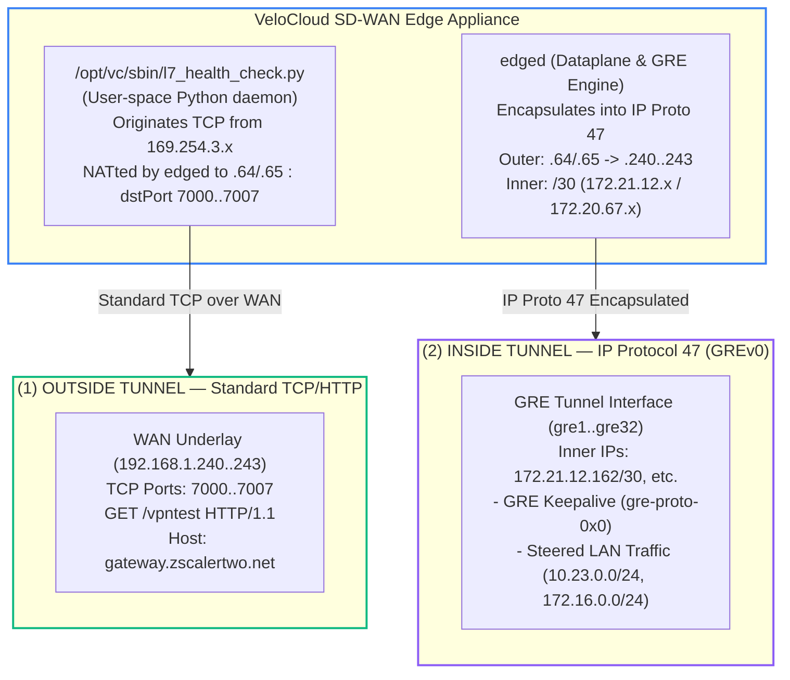
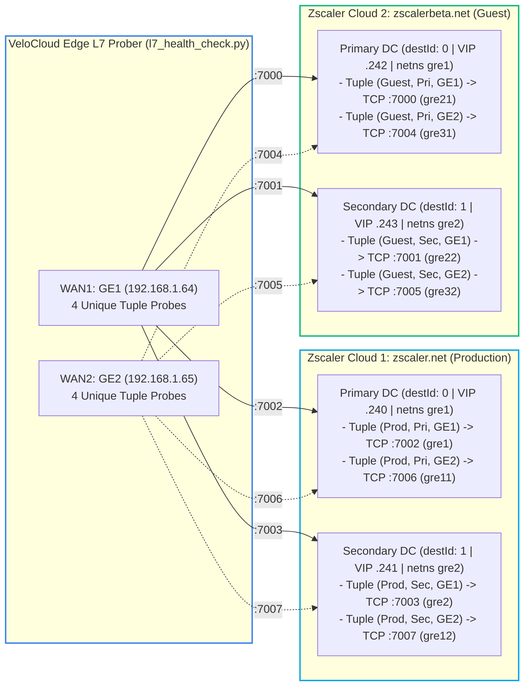
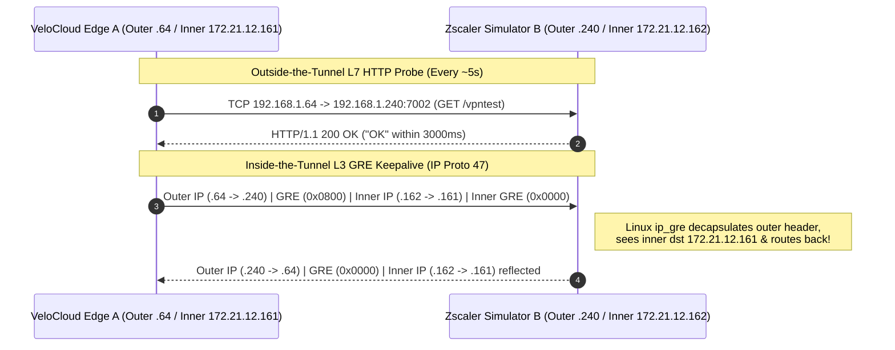

# Deep Dive: Outside-the-Tunnel L7 Health Checks vs. Inside-the-Tunnel GRE Monitoring

When integrating a **VMware VeloCloud SD-WAN Edge** with **Zscaler Internet Access (ZIA)** via Cloud Security Service (CSS) GRE tunnels, tunnel health and failover decisions depend on two distinct mechanisms operating at different layers:

1. **Layer 7 HTTP Health Checks (`GET /vpntest`)** — executed **OUTSIDE** the GRE tunnel over direct WAN IP routing.
2. **Layer 3 GRE Tunnel Encapsulation & Keepalives (`ip_gre` / `gre-proto-0x0`)** — executed **INSIDE** the GRE tunnel.

This document explains how both mechanisms work under the hood, how VeloCloud dynamically maps ports `7000`–`7063`, how to inspect health check state on the Edge CLI, and what firmware edge-cases to watch out for.

---

## 1. Visual Comparison: Outside-the-Tunnel L7 vs. Inside-the-Tunnel GRE




<details>
<summary>📟 View Terminal-Friendly ASCII Comparison Diagram</summary>

```text
+-----------------------------------------------------------------------------+
|                    VELOCLOUD SD-WAN EDGE APPLIANCE                          |
|                                                                             |
|  +-----------------------------------+  +--------------------------------+  |
|  | /opt/vc/sbin/l7_health_check.py   |  | edged (Dataplane & GRE Engine) |  |
|  | (User-space Python daemon)        |  | (Kernel/Dataplane forwarding)  |  |
|  +-----------------+-----------------+  +----------------+---------------+  |
|                    |                                     |                  |
|   Originates TCP from 169.254.3.x        Encapsulates into IP Proto 47      |
|   NATted by edged to WAN IP (.64/.65)    Outer: .64/.65 -> .240..243        |
|    & mapped to dstPort 7000..7007         Inner: /30 (172.21.12.x / 20.67.x) |
+--------------------+-------------------------------------+------------------+
                     |                                     |
                     | (1) OUTSIDE TUNNEL                  | (2) INSIDE TUNNEL
                     | Standard TCP/HTTP                   | IP Protocol 47 (GREv0)
                     v                                     v
+--------------------------------------+  +-----------------------------------+
| WAN Underlay (192.168.1.240..243)    |  | GRE Tunnel Interface (gre1..gre32)|
| TCP Ports: 7000, 7001, 7002, 7003,   |  | Inner IPs: 172.21.12.162/30, etc. |
|            7004, 7005, 7006, 7007    |  |                                   |
|                                      |  | Carries:                          |
| HTTP Request:                        |  | - GRE Keepalive (gre-proto-0x0)   |
|   GET /vpntest HTTP/1.1              |  | - Steered enterprise/guest traffic|
|   Host: gateway.zscalertwo.net       |  |   (10.23.0.0/24, 172.16.0.0/24)   |
|   User-Agent: VMware SD-WAN          |  |                                   |
+--------------------------------------+  +-----------------------------------+
```

</details>

---

## 2. Anatomy of VeloCloud's L7 Health Check (`GET /vpntest`)

### How the Edge Originates L7 Probes
On the VeloCloud Edge, Layer 7 health checks are driven by `/opt/vc/sbin/l7_health_check.py` and coordinated by `edged`:

1. **Port Pool Allocation (`7000`–`7063`):**
   When CSS L7 Health Checks are enabled, `edged` allocates destination ports out of the range `7000`–`7063` (logged in `/var/log/edged.log` as `[NVS] l7_health_dst_port_int: L7 Health dst ports range 7000--7063`).
2. **One Port per `(Cloud, Destination DC, WAN Link)` Tuple:**
   Each combination of:
   - **CSS Service / Zscaler Cloud (`nvsLogicalId`)**: Production (`zscaler.net`) vs. Guest (`zscalerbeta.net`)
   - **Datacenter (`destId`)**: `0` (Primary DC) vs. `1` (Secondary DC)
   - **WAN Interface (`linkLogicalId`)**: `GE1` (`192.168.1.64`) vs. `GE2` (`192.168.1.65`)
   receives its own dedicated port from `7000` to `7007` (4 ports per WAN interface, 4 ports per Zscaler Cloud):



| `dstPort` | `cloud` | `destId` | `nvsIp` (Zscaler VIP) | WAN Link | Simulator Namespace |
| :--- | :--- | :--- | :--- | :--- | :--- |
| **`7000`** | `zscalerbeta.net` (Guest) | `0` (Primary) | `192.168.1.242` | `GE1` (`.64`) | `gre1` |
| **`7001`** | `zscalerbeta.net` (Guest) | `1` (Secondary) | `192.168.1.243` | `GE1` (`.64`) | `gre2` |
| **`7002`** | `zscaler.net` (Prod) | `0` (Primary) | `192.168.1.240` | `GE1` (`.64`) | `gre1` |
| **`7003`** | `zscaler.net` (Prod) | `1` (Secondary) | `192.168.1.241` | `GE1` (`.64`) | `gre2` |
| **`7004`** | `zscalerbeta.net` (Guest) | `0` (Primary) | `192.168.1.242` | `GE2` (`.65`) | `gre1` |
| **`7005`** | `zscalerbeta.net` (Guest) | `1` (Secondary) | `192.168.1.243` | `GE2` (`.65`) | `gre2` |
| **`7006`** | `zscaler.net` (Prod) | `0` (Primary) | `192.168.1.240` | `GE2` (`.65`) | `gre1` |
| **`7007`** | `zscaler.net` (Prod) | `1` (Secondary) | `192.168.1.241` | `GE2` (`.65`) | `gre2` |

3. **HTTP Request & Expected Response Format:**
   Every ~5 seconds per endpoint, the Edge sends:
   ```http
   GET /vpntest HTTP/1.1
   Host: gateway.zscalertwo.net
   Accept: */*
   User-Agent: VMware SD-WAN
   ```
   And expects a `200 OK` HTTP response within **3000 ms (3.0 seconds)**:
   ```http
   HTTP/1.1 200 OK
   Content-Type: text/plain
   Content-Length: 2
   Connection: close

   OK
   ```

4. **Failover & Hold-Down Timers:**
   - **Probe Interval:** ~5 seconds
   - **Failure Threshold:** 3 consecutive failed probes (or probes exceeding the `3000 ms` RTT threshold) -> triggers failover from Primary DC (`destId: 0`) to Secondary DC (`destId: 1`) on that WAN link (~10–15 seconds total detection time).
   - **Preemption / Switchback Hold-Down:** Once traffic fails over to the Secondary Zscaler tunnel, VeloCloud expects the Primary tunnel to remain stable for **30 minutes** before steering traffic back to Primary (see Broadcom Issue `79598`).

---

## 3. Inside-the-Tunnel Monitoring: Cisco-Style GRE Keepalives (`gre-proto-0x0`)

In addition to L7 HTTP probes, GRE tunnels can use **Layer 3 GRE Keepalives** inside the tunnel itself.

### How GRE Keepalive Encapsulation Works
A standard Cisco/VeloCloud GRE keepalive packet is a **GRE-in-GRE** packet generated by the tunnel source (`A`) toward the tunnel destination (`B`), where the **inner IP header has reversed source and destination IPs** (`B -> A`) and an inner GRE protocol type of `0x0000`:



<details>
<summary>📟 View Terminal-Friendly ASCII GRE Keepalive Header Diagram</summary>

```text
+-----------------------------------------------------------------------------+
|       GRE KEEPALIVE PACKET ORIGINATED BY VELOCLOUD EDGE (A -> B)            |
+-----------------------------------------------------------------------------+
| Outer IP Header  | GRE Header | Inner IP Header  | Inner GRE Header         |
| src: 172.21.12.161| proto: IP  | src: 172.21.12.162| proto: 0x0000 (Keepalive)|
| dst: 172.21.12.162| (0x0800)   | dst: 172.21.12.161| (length 4, empty payload)|
+-----------------------------------------------------------------------------+
```

</details>

When the remote GRE endpoint (`B`) decapsulates the outer GRE header, it sees an inner IP packet whose destination is `A` (`172.21.12.161`) and simply routes that inner packet right back through the tunnel to `A`:

```text
12:26:29.542111 IP 192.168.1.64 > 192.168.1.240: GREv0, length 28:
    IP 172.21.12.162 > 172.21.12.161: GREv0, length 4: gre-proto-0x0
12:26:29.561303 IP 192.168.1.240 > 192.168.1.64: GREv0, length 28:
    IP 172.21.12.162 > 172.21.12.161: GREv0, length 4: gre-proto-0x0
```

> **Linux `ip_gre` Note:** Notice that in VeloCloud's implementation, the inner IP header of the keepalive uses the **inner `/30` tunnel IPs** (`172.21.12.162 > 172.21.12.161`) rather than the outer WAN IPs (`192.168.1.240 > 192.168.1.64`). Standard eBPF/XDP GRE keepalive responders that strictly assert `inner_iphdr->saddr == outer_iphdr->daddr` will drop these packets unless that check is relaxed or Linux IP forwarding + `accept_local=1` handles the inner packet reflection.

---

## 4. Debugging L7 & GRE Health Checks on the VeloCloud Edge CLI

When logged into the VeloCloud Edge via SSH (or Remote Diagnostics), use these commands to inspect live L7 health check mappings and logs:

### 1. Dump Active L7 Health Check Configurations
```bash
/opt/vc/bin/debug.py --l7_health_checks
```
Example output (with synthetic lab UUIDs):
```json
[
  {
    "cloud": "zscaler.net",
    "destId": 0,
    "dstPort": 7002,
    "enterpriseLogicalId": "00000000-0000-0000-0000-000000000000",
    "linkLogicalId": "00000001-1111-2222-3333-444444444444",
    "nvsIp": "192.168.1.240",
    "nvsLogicalId": "aaaa0001-bbbb-cccc-dddd-eeeeeeee0001",
    "segmentId": 0,
    "srcIp": "169.254.3.1"
  },
  {
    "cloud": "zscaler.net",
    "destId": 1,
    "dstPort": 7003,
    "enterpriseLogicalId": "00000000-0000-0000-0000-000000000000",
    "linkLogicalId": "00000001-1111-2222-3333-444444444444",
    "nvsIp": "192.168.1.241",
    "nvsLogicalId": "aaaa0001-bbbb-cccc-dddd-eeeeeeee0001",
    "segmentId": 0,
    "srcIp": "169.254.3.1"
  }
]
```

To print a clean sorted CSV table of all monitored `(cloud, nvsIp, dstPort)` tuples:
```bash
/opt/vc/bin/debug.py --l7_health_checks | jq -r '.[] | [ .cloud, .nvsIp, .dstPort ] | @csv' | sort
```

### 2. Inspect L7 Probe Execution Logs
```bash
tail -f /var/log/l7_health_check.log
# or on older firmware:
tail -f /tmp/log/l7_health_check.log
```
Example log lines:
```text
INFO [MainThread] Perform L7 health check from 169.254.3.1 to 192.168.1.240:7002 for aaaa0001-bbbb-cccc-dddd-eeeeeeee0001
INFO [MainThread] Request completed in 297 ms
```

### 3. Inspect `edged.log` Port Allocations
```bash
grep NVS /var/log/edged.log | grep dst_port
```
```text
MSG [NVS] l7_health_dst_port_int:1252 L7 Health dst ports range 7000--7063
MSG [NVS] update_nvs_path_mutable_props:1183 L7 health check dst_port=7000 00000001-1111-2222-3333-444444444444
MSG [NVS] update_nvs_path_mutable_props:1183 L7 health check dst_port=7001 00000001-1111-2222-3333-444444444444
MSG [NVS] update_nvs_path_mutable_props:1183 L7 health check dst_port=7002 00000002-1111-2222-3333-444444444444
MSG [NVS] update_nvs_path_mutable_props:1183 L7 health check dst_port=7003 00000002-1111-2222-3333-444444444444
```

---

## 5. Known VeloCloud Firmware Quirks & Public Defect References

During lab testing across multiple VeloCloud SD-WAN Edge firmware releases, several important behaviors and public Broadcom/VMware defects were identified:

| Firmware / Defect ID | Observed Behavior & Resolution |
| :--- | :--- |
| **Release 4.5.2 (Lab Observation)** | L7 HTTP probes were observed originating primarily from the 2nd/standby WAN interface (`GE2`), only switching to `GE1` when `GE2` was disconnected. In Release `5.4.x`, probing originates properly per WAN interface. |
| **Defect `60073`** *(Fixed in 4.2.2+, 4.3.1+, 4.5.0+)* | After a service restart or reboot, a Zscaler tunnel configured with an FQDN may stay down because the Edge's internal DNS cache lacks an entry for the Zscaler FQDN. Workaround: trigger a Remote Diagnostics ping to the Zscaler peer FQDN. |
| **Defect `81852`** *(5.0.0 -> Fixed in 5.4+)* | Intermittent `socket getaddress` errors during startup/upgrade when L7 Health Check is enabled on a GRE-based CSS, causing L7 probes not to be sent. Workaround: toggle L7 Health Check off and back on. |
| **Defect `79598`** *(Fixed in 5.4+)* | After failing over from Primary to Secondary Zscaler tunnel, traffic switches back to Primary in less than the required **30-minute** stability hold-down window. |
| **Defect `122029`** *(5.2.x -> Fixed in 5.4+)* | Deploying Zscaler CSS with GRE Automation on 5.2.x can drop backhauled traffic if all tunnels are deleted by the Orchestrator until CSS is disabled and re-enabled. |
| **Defect `83526`** *(Fixed in 6.0+)* | L7 Health Check for a specific WAN link could falsely report `UP` even when that WAN link was `DOWN` if multiple WAN links shared a common health check destination IP (such as Zscaler VIPs). |
| **Defect `136336`** *(Fixed in 6.0+)* | Return traffic from Zscaler GRE tunnels may be dropped due to a Reverse Path Forwarding (RPF) lookup failure when the Common Criteria Firewall is enabled on the Edge. |
| **Defect `134332`** *(Fixed in 6.1+)* | Modifying the Business Policy associated with the L7 Health Check flow could redirect L7 probes to the open internet instead of the CSS path, causing CSS tunnels to flap and drop steered traffic. |
