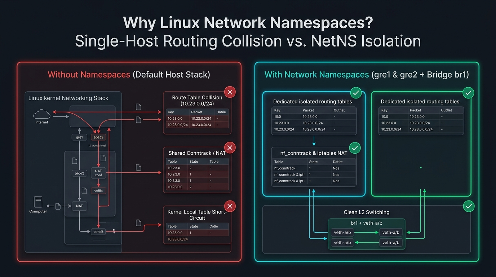
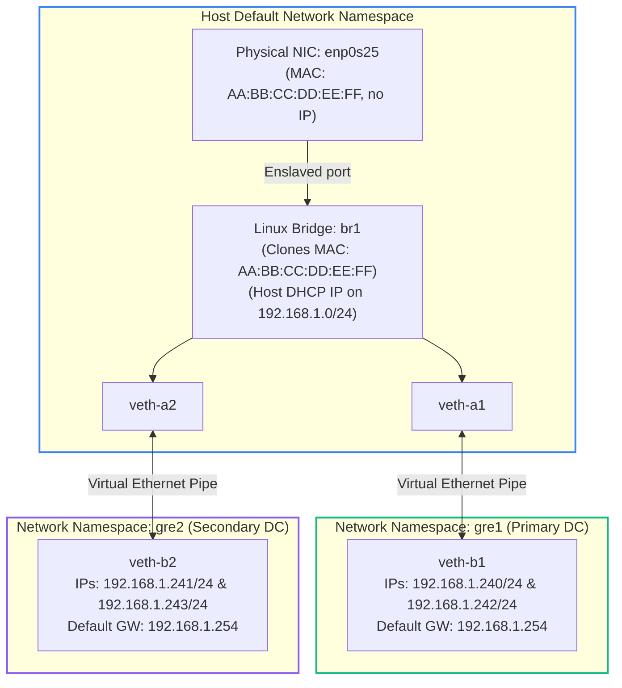
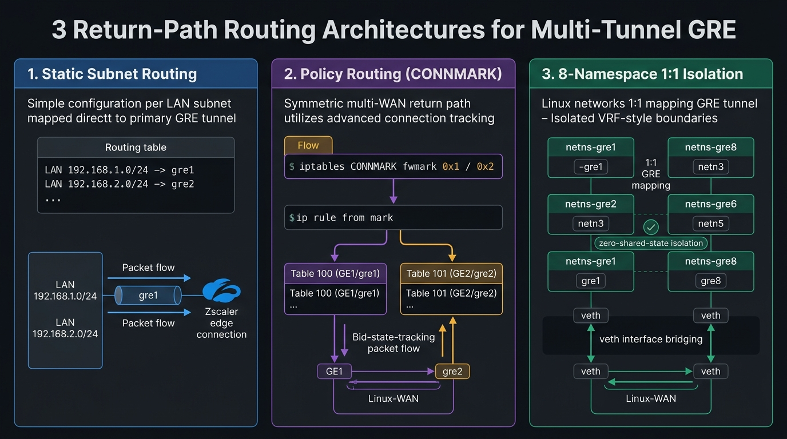

# Deep Dive: Linux Network Namespaces, Bridging & Return-Path Routing

This document explains the networking internals behind the VeloCloud-to-Zscaler GRE Simulator: **why** Linux Network Namespaces (`gre1` and `gre2`) are necessary, **how** a single physical Ethernet port (`enp0s25`) is shared across the host and multiple virtual Zscaler datacenters, **how** the Python orchestrator binds sockets inside namespaces using `setns()`, and **how** return-path routing works when NATting traffic from multiple GRE tunnels.

---

## 1. Why Network Namespaces Are Required on a Single Host



When a VeloCloud SD-WAN Edge is configured with dual WAN interfaces (`GE1` = `192.168.1.64`, `GE2` = `192.168.1.65`) and two Cloud Security Service (CSS) profiles (`Production` and `Guest`), it establishes **8 separate GRE tunnels** toward 4 Zscaler Virtual IPs (VIPs):

- `192.168.1.240` — Production Primary Zscaler DC
- `192.168.1.241` — Production Secondary Zscaler DC
- `192.168.1.242` — Guest Primary Zscaler DC
- `192.168.1.243` — Guest Secondary Zscaler DC

If you attempted to configure all 4 IP aliases and all 8 `ip_gre` tunnels directly in the Linux host's default network namespace, three problems would immediately break the simulation:

1. **Overlapping Return Routes to Client Subnets:**
   Both the Primary DC (`gre1`/`gre11`/`gre21`/`gre31`) and the Secondary DC (`gre2`/`gre12`/`gre22`/`gre32`) need routes back to the VeloCloud Edge's behind-the-Edge LAN subnets (`10.23.0.0/24` for Production and `172.16.0.0/24` for Guest). In a single routing table, you cannot have two active primary routes for `10.23.0.0/24` pointing to both Primary and Secondary GRE tunnels without one shadowing the other.
2. **Conntrack & NAT State Collisions:**
   When the Edge fails over from the Primary Zscaler DC (`.240`) to the Secondary Zscaler DC (`.241`), a real Zscaler cloud processes the traffic in a completely separate datacenter with its own independent stateful firewall and NAT table. Isolating `gre1` (Primary DC) and `gre2` (Secondary DC) into separate Linux Network Namespaces gives each datacenter its own independent `nf_conntrack` table, `iptables` chains, and routing table.
3. **Host OS Routing & NetworkManager Interference:**
   By placing the simulated Zscaler VIPs and GRE tunnels inside `gre1` and `gre2`, the host OS's own routing table, SSH management sessions, and local applications remain completely unaffected by tunnel state changes or firewall rules.

---

## 2. Layer 2 Bridge (`br1`) & MAC Address Preservation (`mknetns-gre1.sh`)

To make the isolated namespaces `gre1` and `gre2` reachable on the physical `192.168.1.0/24` network where the VeloCloud Edge's `GE1` (`.64`) and `GE2` (`.65`) ports reside, `mknetns-gre1.sh` builds a Layer 2 software switch (`br1`):



<details>
<summary>📟 View Terminal-Friendly ASCII Bridge & Namespace Diagram</summary>

```text
+-----------------------------------------------------------------------------+
|                     HOST DEFAULT NETWORK NAMESPACE                          |
|                                                                             |
|   Physical NIC: enp0s25 (MAC: AA:BB:CC:DD:EE:FF, no IP address)             |
|         |                                                                   |
|         +---> Enslaved to Linux Bridge: br1                                 |
|               (Explicitly assigned MAC: AA:BB:CC:DD:EE:FF)                  |
|               (Receives Host DHCP IP on 192.168.1.0/24)                     |
|                     |                                 |                     |
|               [ veth-a1 ]                       [ veth-a2 ]                 |
+---------------------|---------------------------------|---------------------+
                      | (Virtual Ethernet Pipe)         | (Virtual Ethernet Pipe)
+---------------------|-------------+     +-------------|---------------------+
| NAMESPACE: gre1     |             |     | NAMESPACE: gre2                   |
|               [ veth-b1 ]         |     |       [ veth-b2 ]                 |
|   IPs: 192.168.1.240/24           |     |   IPs: 192.168.1.241/24           |
|        192.168.1.242/24           |     |        192.168.1.243/24           |
|   Default GW: 192.168.1.254       |     |   Default GW: 192.168.1.254       |
+-----------------------------------+     +-----------------------------------+
```

</details>

### Why `br1` Clones `enp0s25`'s MAC Address
By default, the Linux kernel assigns a newly created bridge either a random MAC address or the lowest MAC address among its enslaved ports (`veth-a1` or `veth-a2`). If `br1` gets a new MAC address when `dhclient br1` runs, the LAN DHCP server assigns the host a **different IP address**, breaking existing SSH sessions or static gateway routes.

`mknetns-gre1.sh` prevents this by reading the hardware MAC address of `enp0s25` via `ip -json link show` and explicitly locking `br1` to that MAC:

```bash
ORIG_MAC=$(ip -json link show dev "$NIC" | jq -r .[].address)
ip link add name br1 address "$ORIG_MAC" up type bridge
```

### Co-Existence with `macvlan` Companion Labs
In Linux, a physical interface (`enp0s25`) that has `macvlan` sub-interfaces attached to it cannot be enslaved to a bridge (`ip link set enp0s25 master br1` fails with `RTNETLINK answers: Device or resource busy`). However, the reverse **is** allowed: you can attach `macvlan` interfaces to a bridge (`br1`)!

When `mknetns-gre1.sh` detects `macvlan` interfaces on `enp0s25` (even inside other network namespaces such as `nshost`), Option `2` automatically:
1. Inspects the namespace, IP address, operational state, and routes of each `macvlan` child.
2. Deletes the `macvlan` from `enp0s25` and enslaves `enp0s25` to `br1`.
3. Recreates the `macvlan` with `br1` as its parent (`ip link add <name> link br1 type macvlan mode bridge`), moves it back into its namespace, and restores its IP and default route.

---

## 3. Kernel Sysctls Inside the Namespaces (`doit.sh`)

Three kernel parameters set in `doit.sh` are essential for the simulator to forward traffic properly:

1. **`net.ipv4.ip_forward=1` (in `gre1` and `gre2`):**
   Allows packets decapsulated from the GRE tunnel interfaces (`gre1`..`gre32`) to be routed out via `veth-b1`/`veth-b2` toward the upstream internet gateway (`192.168.1.254`).
2. **`net.ipv4.conf.all.accept_local=1` and `net.ipv4.conf.default.accept_local=1`:**
   Allows the namespace kernel stack to accept packets whose source IP matches a local address when testing or hair-pinning between local interfaces on the same host.
3. **`net.ipv4.conf.br1.proxy_arp=1` and `net.ipv4.conf.enp0s25.proxy_arp=1`:**
   Helps with ARP resolution on the `192.168.1.0/24` LAN segment for the `.240`–`.243` VIPs living behind `br1`.

> **Important Note on Upstream Gateway Return Traffic:**
> When user traffic from the VeloCloud Edge (`10.23.0.0/24` or `172.16.0.0/24`) traverses a GRE tunnel into `gre1` or `gre2`, `iptables -t nat -A POSTROUTING -j MASQUERADE` rewrites its source IP to the namespace's primary VIP (`192.168.1.240` or `192.168.1.241`) before sending it to the LAN gateway (`192.168.1.254`). Because `veth-b1` and `veth-b2` are bridged onto `br1`, `192.168.1.240`–`.243` are directly reachable at Layer 2 via ARP on `192.168.1.0/24`. If your upstream router does not ARP for `.240/30` (for instance, if `.240/30` is placed in a different subnet), add a static route on the upstream gateway pointing `192.168.1.240/30` to the simulator host.

---

## 4. The Multi-Tunnel Return-Path Routing Problem (and 3 Solutions)



Inside namespace `gre1`, there are **four** active GRE tunnels terminating from the same VeloCloud Edge:
- `gre1`: Production Primary over `GE1` (`.64`)
- `gre11`: Production Primary over `GE2` (`.65`)
- `gre21`: Guest Primary over `GE1` (`.64`)
- `gre31`: Guest Primary over `GE2` (`.65`)

Suppose a client in the Guest subnet (`172.16.0.14`) sends a packet through the VeloCloud Edge, and the Edge steers it over **WAN2 (`GE2`)**, arriving in `gre1` on interface **`gre31`**:

```text
1. Egress (Client -> Internet):
   Client (172.16.0.14) --> Edge GE2 --> [GRE Tunnel gre31] --> netns gre1
   --> MASQUERADE SNAT (src becomes 192.168.1.240) --> veth-b1 --> Internet

2. Ingress Reply (Internet -> Client):
   Internet --> veth-b1 (dst=192.168.1.240)
   --> Conntrack un-NATs dst back to 172.16.0.14
   --> Kernel looks up 172.16.0.14 in netns gre1 routing table!
```

At step 2, how does the kernel in `gre1` know whether to route `172.16.0.14` back into `gre21` (`GE1`) or `gre31` (`GE2`)?

```mermaid
flowchart TB
    subgraph OPT1["Option 1: Static Route per Segment (Default)"]
        O1_IN["Ingress on gre1 (GE1) or gre11 (GE2)"] --> O1_RT["Single Main Routing Table:\n10.23.0.0/24 -> dev gre1\n172.16.0.0/24 -> dev gre21"]
        O1_RT --> O1_OUT["Always returns via GE1 (gre1/gre21)\nSimple, but asymmetric if egress used GE2"]
    end

    subgraph OPT2["Option 2: Stateful CONNMARK Policy Routing"]
        O2_IN["PREROUTING on gre1/11/21/31:\nCONNMARK --set-mark 1 / 11 / 21 / 31"] --> O2_RET["Reply on veth-b1:\nCONNMARK --restore-mark"]
        O2_RET --> O2_RULE["ip rule fwmark -> Table 101 / 111 / 121 / 131\n100% Symmetric Return on exact ingress GRE tunnel"]
    end

    subgraph OPT3["Option 3: 8-Namespace 1:1 Isolation"]
        O3_IN["8 Dedicated Namespaces\n(1 NetNS per GRE Tunnel)"] --> O3_OUT["1 veth + 1 GRE tunnel + 1 default return route\nZero shared routing state (requires 8 VIPs)"]
    end

    style OPT1 stroke:#3b82f6,stroke-width:2px
    style OPT2 stroke:#10b981,stroke-width:2px
    style OPT3 stroke:#8b5cf6,stroke-width:2px
```



### Solution Option 1: Static Route per Segment (Default in `doit.sh`)
```bash
ip -n gre1 route add 172.16.0.0/24 dev gre21  # Guest return path
ip -n gre2 route add 172.16.0.0/24 dev gre22
ip -n gre1 route add 10.23.0.0/24  dev gre1   # Prod return path
ip -n gre2 route add 10.23.0.0/24  dev gre2
```
- **Pros:** Minimal configuration (4 lines); works immediately when `GE1` is the primary active WAN link.
- **Cons:** Asymmetric if the Edge sends outbound packets over `GE2` (`gre11`/`gre31`), because return packets still flow back into `gre1`/`gre21` (`GE1`). If the VeloCloud Edge has strict Common Criteria / Reverse Path Forwarding (RPF) enabled, asymmetric return packets may be dropped.

### Solution Option 2: Stateful `CONNMARK` Policy Routing (Symmetric within 2 Namespaces)
Using `iptables -t mangle -j CONNMARK` and Linux Policy Routing (`ip rule` + per-tunnel routing tables `101`, `111`, `121`, `131`), `gre1` can remember which GRE tunnel each connection arrived on and send return packets back down the exact same tunnel:

```bash
# 1. Mark connections in PREROUTING based on ingress GRE interface and save to conntrack
ip netns exec gre1 iptables -t mangle -A PREROUTING -i gre1  -j CONNMARK --set-mark 1
ip netns exec gre1 iptables -t mangle -A PREROUTING -i gre11 -j CONNMARK --set-mark 11
ip netns exec gre1 iptables -t mangle -A PREROUTING -i gre21 -j CONNMARK --set-mark 21
ip netns exec gre1 iptables -t mangle -A PREROUTING -i gre31 -j CONNMARK --set-mark 31

# 2. Restore the connection mark onto reply packets arriving from the internet on veth-b1
ip netns exec gre1 iptables -t mangle -A PREROUTING -i veth-b1 -j CONNMARK --restore-mark

# 3. Direct marked reply packets to dedicated per-tunnel routing tables
ip netns exec gre1 ip rule add fwmark 1  table 101
ip netns exec gre1 ip rule add fwmark 11 table 111
ip netns exec gre1 ip rule add fwmark 21 table 121
ip netns exec gre1 ip rule add fwmark 31 table 131

# 4. Populate each table with its corresponding GRE tunnel interface
ip netns exec gre1 ip route add 10.23.0.0/24  dev gre1  table 101
ip netns exec gre1 ip route add 10.23.0.0/24  dev gre11 table 111
ip netns exec gre1 ip route add 172.16.0.0/24 dev gre21 table 121
ip netns exec gre1 ip route add 172.16.0.0/24 dev gre31 table 131
```
- **Pros:** 100% symmetric per-flow routing; works with dual-WAN active/active load balancing and strict RPF checks.
- **Cons:** 16 `ip rule` / `iptables` rules and 8 routing tables across `gre1` and `gre2`.

### Solution Option 3: 8-Namespace Architecture (1 Namespace per GRE Tunnel)
Instead of grouping 4 tunnels into `gre1` and 4 tunnels into `gre2`, you can create **8 network namespaces** (`prod-pri-ge1`, `prod-pri-ge2`, `guest-pri-ge1`, `guest-pri-ge2`, etc.), each with 1 `veth` pair, 1 GRE tunnel, and 1 static route.
- **Pros:** Zero policy routing needed; 1:1 mapping with the 8 orchestrator listener threads; trivial routing table per namespace.
- **Cons:** Requires 8 distinct Zscaler VIPs (or L2/ebtables steering per source Edge WAN IP) because two namespaces on the same bridge cannot claim the same `192.168.1.240` IP without ARP conflicts.

---

## 5. How the Python Orchestrator Enters Namespaces (`pyroute2` + `setns()`)

A common pitfall when writing multi-namespace network tools in Python is assuming that `with pyroute2.NetNS('gre1'):` switches the calling Python thread's network namespace. In `pyroute2`, `NetNS` spawns a helper netlink proxy process inside the namespace for netlink queries (`IPRoute`), but **standard Python `socket.socket()` calls still execute in the host's default namespace**.

To actually bind TCP sockets to `192.168.1.240:7002` inside `gre1` and `192.168.1.241:7003` inside `gre2` from a single Python process, `zscaler_orchestrator_pyroute2.py` combines `pyroute2` (for namespace verification and netlink introspection) with a direct Linux `setns(2)` system call via `ctypes` inside each worker thread:

```python
import ctypes
import os
import socket

# 1. Open the network namespace file descriptor mounted by iproute2
nsfd = os.open(f'/var/run/netns/{namespace}', os.O_RDONLY)

# 2. Invoke libc setns(nsfd, CLONE_NEWNET) to move ONLY the current pthread
libc = ctypes.CDLL('libc.so.6', use_errno=True)
CLONE_NEWNET = 0x40000000
if libc.setns(nsfd, CLONE_NEWNET) == -1:
    errno = ctypes.get_errno()
    raise OSError(errno, f"setns failed: {os.strerror(errno)}")
os.close(nsfd)

# 3. Create, bind, and accept() on the TCP socket inside the namespace
sock = socket.socket(socket.AF_INET, socket.SOCK_STREAM)
sock.setsockopt(socket.SOL_SOCKET, socket.SO_REUSEADDR, 1)
sock.bind((ip, port))
sock.listen(5)
```

Because `setns(fd, CLONE_NEWNET)` is a **per-thread** attribute in the Linux kernel (`struct nsproxy` is per-task/`pthread`), all 8 listener threads share the same Python memory space (`ENDPOINTS` status dictionary and `stats` counters) while their network I/O is completely isolated inside `gre1` or `gre2`!
